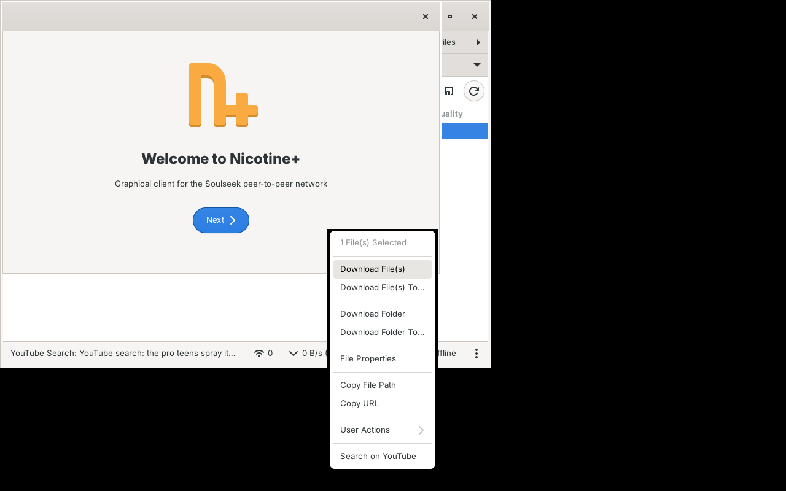

# YouTube Search plugin for Nicotine+

> **Unofficial.** This plugin is not made or endorsed by the Nicotine+ developers. It was made with the help of [Claude](https://claude.ai), an AI assistant by Anthropic.

Adds **Search on YouTube** to the right-click menu of files when you browse a user's shares. It guesses the artist and title from the file name and opens a YouTube search in your browser.

Tested with Nicotine+ 3.3.7 and 3.3.11.

## Install on Windows

1. Download `youtube_search-release.zip` from the [latest release](../../releases/latest) and unzip it.
2. Close Nicotine+.
3. Press Win+R, type `%AppData%\nicotine`, and press Enter.
4. If there is no `plugins` folder there, create one.
5. Copy the whole `youtube_search` folder into `plugins`, so you have `%AppData%\nicotine\plugins\youtube_search\__init__.py`.
6. Start Nicotine+. Go to Preferences, then Plugins, tick **YouTube Search**, and click Apply.
7. Close and reopen any browse tabs that were already open. The new menu item only appears in tabs opened after the plugin is enabled.

Tip: Preferences > Plugins > **Add Plugins** opens the plugins folder for you.

## Install on Linux and macOS

Same steps, but the plugins folder is `~/.local/share/nicotine/plugins` on Linux and `~/Library/Application Support/nicotine/plugins` on macOS. Flatpak users: `~/.var/app/org.nicotine_plus.Nicotine/data/nicotine/plugins`.

## Use

- Right-click one or more files in a browse tab and choose **Search on YouTube**. By default it opens the **first video** from the results straight away, skipping ads. If it can't find one (no internet, YouTube changed its page), it opens the normal search results instead. Each selected file opens its own tab, up to 5 at a time.
- To get the results page every time instead, untick **Open the first video directly** in the plugin settings.
- Or type `/yt <file name or text>` in a chat box.
- In the plugin settings you can change the search URL, for example to `https://music.youtube.com/search?q=%s`.

## How the name is cleaned up

| File name | Search |
|---|---|
| `01 - Daft Punk - One More Time [320].mp3` | Daft Punk One More Time |
| `2025-07-23 - No Chasa - Shall We Do It Again [ADC024].mp3` | No Chasa Shall We Do It Again |
| `03-the_pro-teens-spray_it_dont_say_it-uvu.mp3` | the pro teens spray it dont say it |
| `Portishead - Glory Box (Official Video).webm` | Portishead Glory Box |
| `Radiohead\OK Computer\03 Subterranean Homesick Alien.flac` | Radiohead Subterranean Homesick Alien |

It removes the extension, track numbers, dates, anything in [square brackets], and noise in (parentheses) like bitrates, years and "Official Video". It turns underscores into spaces and splits on " - ". If the file name has no artist, it takes one from the folder names.

## Caveat

Nicotine+ has no official way for plugins to add file menu items, so this plugin hooks into the browse tab's internal code. A future Nicotine+ release could break it. If that happens, the `/yt` command will still work.

## License

GPL-3.0-or-later, the same license as Nicotine+. See [LICENSE](LICENSE).
